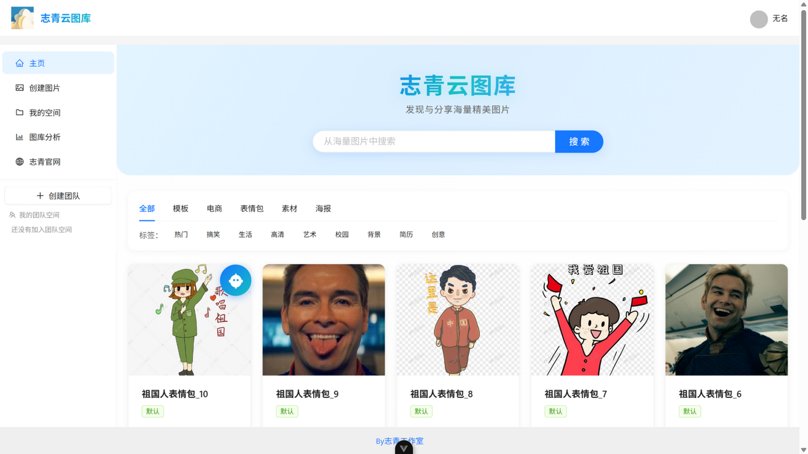
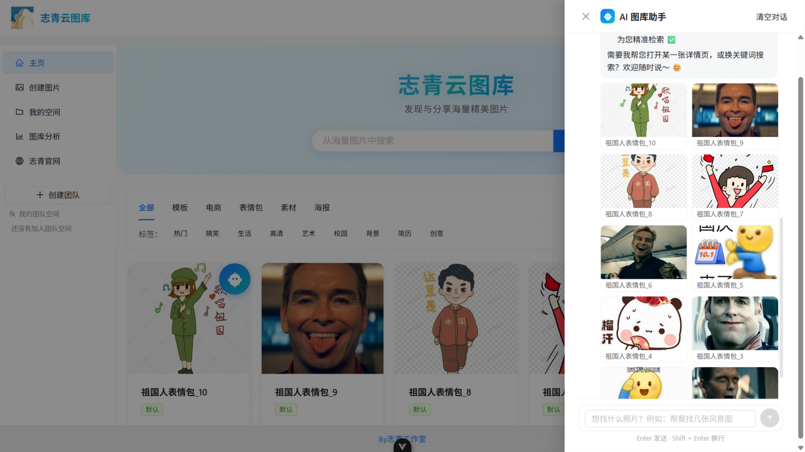
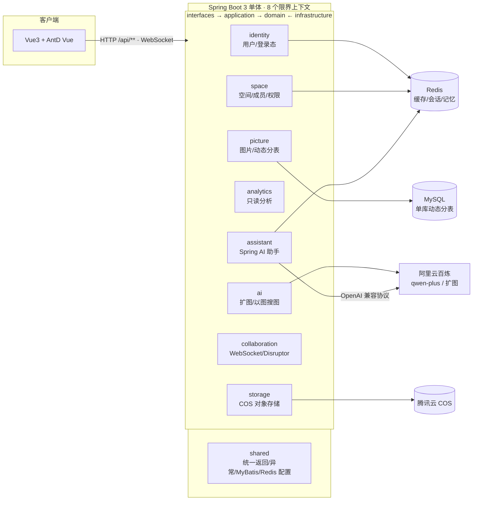
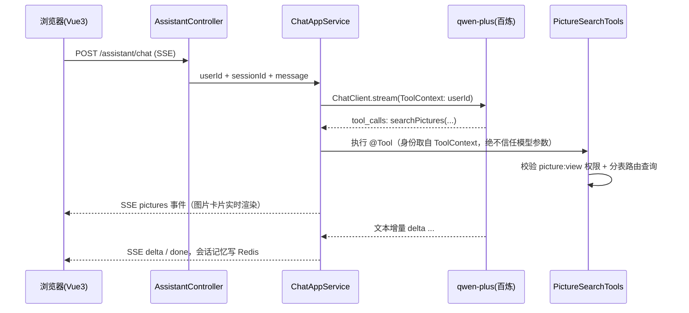

# ZhiQingCloudPicture 志青云图库

基于 **Spring Boot 3 + Vue3** 的企业级智能协同云图库：图片托管（个人空间 / 团队空间 / 公共图库）、团队实时协作修图、以及 AI 能力（Spring AI 对话式找图、阿里云百炼 AI 扩图、以图搜图）。

后端按 DDD 风格划分为 **8 个限界上下文**，以 ArchUnit 单测守护分层依赖方向。

| 首页 · 公共图库 | AI 助手 · 对话式找图 |
|---|---|
|  |  |

---

## 功能特性

- **图片托管**：文件 / URL / 批量抓取上传；WebP 转码压缩与缩略图生成；审核工作流（待审核 → 通过 / 拒绝状态机）；标题 / 简介 / 标签 / 分类检索；主色调相似度搜图
- **空间体系**：个人空间（配额随空间级别：普通 / 专业 / 旗舰版）；团队空间（成员角色 viewer / editor / admin）；公共图库（审核通过后可见）
- **动态分表**：`picture` 逻辑表按空间路由到 `picture_public` / `picture_{spaceId}` 物理表，建空间自动建表
- **团队协作**：WebSocket 实时协同修图（编辑权互斥、增量动作广播、后加入者动作重放），Disruptor 无锁队列削峰
- **AI 能力**：Spring AI 对话助手（4 个 @Tool 工具 + SSE 流式 + Redis 会话记忆）；百炼 SDK 扩图（异步任务轮询）；Bing 以图搜图
- **数据分析**：空间用量 / 分类分布 / 标签分布 / 大小区间 / 用户趋势 / 使用排行
- **后台管理**：用户、图片、空间管理（管理员角色）

## 系统架构



分层依赖由 `src/test/.../architecture/DddArchitectureTest.java`（ArchUnit）强制约束：`domain` 不依赖 Spring / MyBatis / Servlet，旧 MVC 包不得回流。

## 核心设计

### 1. 按空间动态分表

`picture` 逻辑表经 MyBatis-Plus `DynamicTableNameInnerInterceptor` 路由到物理表；分片上下文用 ThreadLocal 承载，只允许出现在 infrastructure 层，领域层通过端口 `PictureTableRouter` 表达"在某个空间里做事"。

```mermaid
flowchart TD
    A[请求携带 spaceId / pictureId] --> B{路由来源}
    B -->|列表查询| C[PictureRepository 内<br/>pictureTableRouter.inSpace 包裹]
    B -->|仅带图片 id| D[SpaceTableContextFilter<br/>按 id 反查空间兜底]
    C --> E[SpaceTableContext ThreadLocal]
    D --> E
    E --> F[PictureTableNameHandler<br/>动态改写表名]
    F --> G[picture_public<br/>公共图库]
    F --> H[picture_{spaceId}<br/>空间表 · 建空间事务提交后自动建表]
```

- 管理员全局列表走 `allScopes()` 跨表查询 + 内存归并排序分页
- id → spaceId 反查结果进 Caffeine 定位缓存（上限 20 万条）

### 2. Caffeine → Redis → MySQL 三级缓存

- 读：本地 Caffeine（5 分钟）→ Redis（随机 300~600s 过期防雪崩）→ MySQL 兜底
- 写：上传 / 编辑 / 删除 / 审核成功后**主动失效两级缓存**，避免"已删除图片仍可见"
- 缓存对象为 VO 序列化结果（实体 `tags` 是 JSON 字符串，直接缓存实体会被前端拆成单字标签）

### 3. AI 助手（Spring AI Tool Calling）



- 4 个工具：`searchPictures` / `getPictureDetail` / `listAccessibleSpaces` / `listSpaceTags`
- 权限：公共图库强制 `reviewStatus=PASS`；空间图库复用 `SpacePermissionAppService` 校验 `picture:view`
- 记忆：实现 Spring AI `ChatMemoryRepository`，20 条窗口、Redis 持久化 30 天

### 4. 团队协作修图

- 编辑权互斥：`ENTER_EDIT` 显式抢占，单编辑者模式
- 后加入者视图一致：服务端记录动作序列，新连接按序重放
- 消息处理与发送解耦：WebSocket 线程只投递，`PictureEditEventWorkHandler`（Disruptor WorkHandler）消费
- 细节：雪花 id 序列化为字符串防前端精度丢失；未知消息类型回 ERROR 而非断连

## 技术栈

| 层 | 技术 |
|---|---|
| 框架 | Spring Boot 3.4 · JDK 17 · Spring AI 1.1（OpenAI 协议 → DashScope compatible-mode） |
| 数据 | MyBatis-Plus 3.5（动态表名 + 分页插件） · MySQL · Redis（Spring Session + 缓存） · Caffeine |
| 鉴权 | 拦截器 + 自定义注解（个人空间）；Sa-Token 多账号体系 RBAC（团队空间） |
| 异步 | Disruptor 3.4（协作消息） · @Async（对象存储清理） |
| 外部 | 腾讯云 COS · 阿里云百炼（qwen-plus / 扩图） · Bing 图片抓取（jsoup） |
| 前端 | Vue3 · TypeScript · Ant Design Vue · Pinia · Vite · ECharts |
| 质量 | JUnit5 + ArchUnit（分层守护） · Knife4j（springdoc openapi3） |

## 快速开始

> 环境：JDK 17 · Maven 3.9 · MySQL 8 · Redis · Node 18+

```bash
# 1. 建库建表（含空间分表模板）
mysql -uroot -p < sql/create_table.sql
mysql -uroot -p < sql/space_table_init.sql

# 2. 后端配置 src/main/resources/application-local.yml
#    填写：datasource、redis、cos.client（腾讯云）、aliYunAi.apikey（百炼）

# 3. 启动后端（8123 端口，context-path=/api）
#    IDEA 直接运行 ZhiqinPictureBackendApplication，或：
mvn compile
java -cp "target/classes;$(mvn dependency:build-classpath -Dmdep.outputFile=cp.txt -q; cat cp.txt)" \
    com.zhiqin.zhiqinpicturebackend.ZhiqinPictureBackendApplication

# 4. 前端（见前端仓库，vite 已配置 /api → 8123 同源代理）
npm install && npm run dev   # http://localhost:5173

# 5. 接口文档
#    http://localhost:8123/api/doc.html  (Knife4j)
```

## 项目结构

```
com.zhiqin.zhiqinpicturebackend
├── identity/        # 注册登录 · 用户档案 · 登录态（User 聚合 / EncryptedPassword 值对象）
├── space/           # 空间生命周期 · 配额(SpaceQuota) · 成员 · Sa-Token 权限源
├── picture/         # 图片聚合(审核状态机) · 动态分表路由 · 仓储实现
├── analytics/       # 空间分析（只读，内存聚合）
├── ai/              # OutPaintingPort / ImageSearchPort 端口 + 阿里云/Bing 适配
├── storage/         # StorageService 端口 + COS 实现 + 上传模板(WebP/缩略图)
├── collaboration/   # WebSocket 协作 + Disruptor 事件管道
├── assistant/       # Spring AI 对话助手（tools / ChatAppService / Redis 记忆）
└── shared/          # 统一返回 · 异常 · 分页 · 全局配置
```

每个上下文内部统一四层：`interfaces`（controller/DTO/VO）→ `application`（用例编排/事务）→ `domain`（聚合/端口，纯 POJO）← `infrastructure`（仓储实现/外部 API）。

## 接口总览（53 个端点）

| 模块 | 前缀 | 数量 | 说明 |
|---|---|---|---|
| 用户 | `/user` | 11 | 注册登录、用户 CRUD、个人资料 |
| 空间 | `/space` | 8 | 空间 CRUD、分页、VO |
| 空间成员 | `/spaceUser` | 6 | 成员增删改查、我的团队空间 |
| 图片 | `/picture` | 19 | 上传/审核/编辑/检索/以图搜图/扩图 |
| 空间分析 | `/space/analyze` | 6 | 用量/分类/标签/大小/趋势/排行 |
| 文件 | `/file` | 2 | COS 测试上传下载 |
| 健康 | `/health` | 1 | 存活探针 |

## Roadmap

- [ ] 图片语义检索（文本 embedding + 向量检索，RAG 入口）
- [ ] 删除空间时级联清理 `picture_{spaceId}` 分表
- [ ] analytics 改为数据库侧聚合查询（当前内存聚合）
- [ ] 多实例部署：JVM 内锁（创建空间防重）替换为分布式锁
- [ ] 团队空间批量邀请与权限继承细化

---

> 作者：崔健 · 志青工作室 · 联系方式见简历
